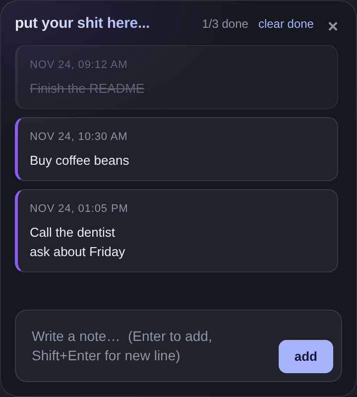

# omanotes

A small frameless desktop notes widget built with [pywebview](https://pywebview.flowrl.com/) (GTK backend) and plain HTML/CSS/JS.



## Features

- Add notes (Enter to add, Shift+Enter for a new line)
- Click a note to mark it done; double-click it to edit (Enter saves, Esc cancels)
- Delete single notes or clear all done notes at once
- Notes are saved to `notes.json` next to the app
- Old `notes.txt` files (`date: content` per line) are imported automatically on first run

## Requirements

- Python 3
- [pywebview](https://pywebview.flowrl.com/) 6+ with the GTK backend (needs WebKitGTK and PyGObject)

Install with pip:

```sh
pip install -r requirements.txt
```

Or on Arch / Omarchy, from the system packages:

```sh
sudo pacman -S python-pywebview python-gobject webkit2gtk-4.1
```

## Run

```sh
python main.py
```

## Files

| File         | Purpose                                  |
|--------------|------------------------------------------|
| `main.py`    | Window setup and the Python API used by the UI |
| `index.html` | Widget markup                            |
| `app.js`     | UI logic, calls the Python API           |
| `style.css`  | Styling                                  |
| `notes.json` | Saved notes                              |

## License

[MIT](LICENSE)
